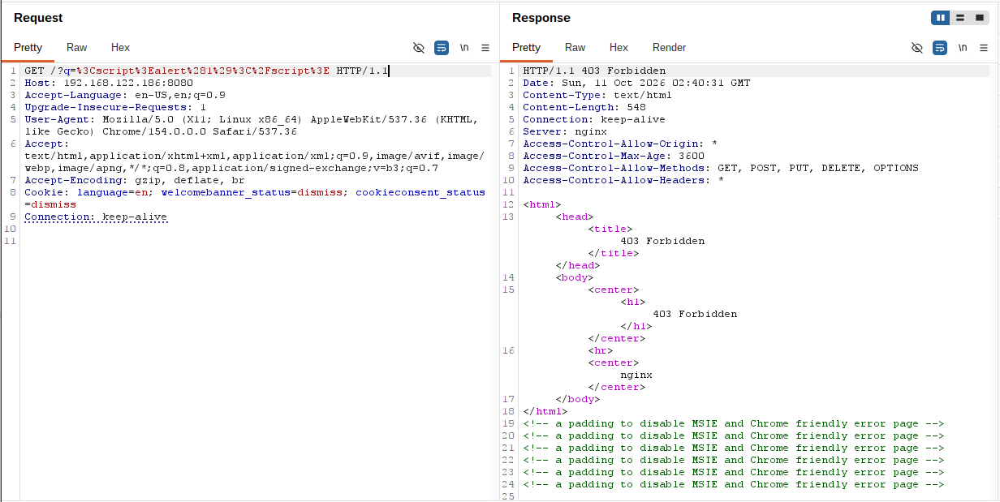
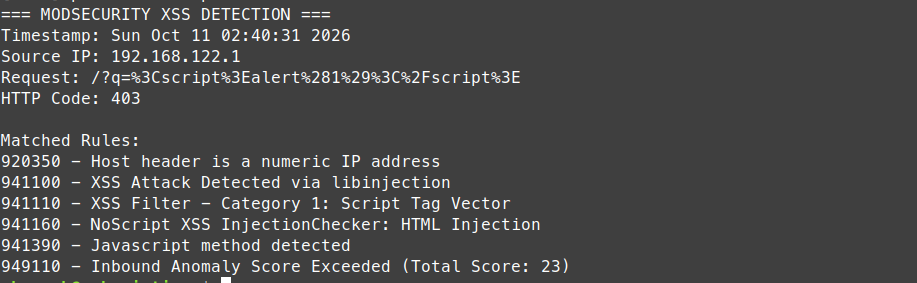
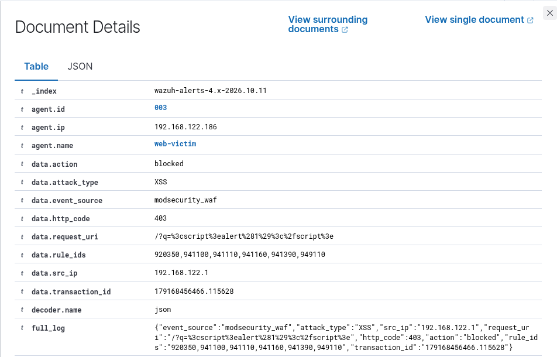

# Incident 001 – Phát hiện và ngăn chặn tấn công XSS

## 1. Tổng quan

Kịch bản thực hành mô phỏng hành vi Cross-Site Scripting (XSS) trên ứng dụng OWASP Juice Shop trong môi trường lab cô lập.

Mục tiêu là kiểm tra khả năng nhận diện và ngăn chặn HTTP Request chứa payload XSS bằng ModSecurity kết hợp OWASP Core Rule Set (CRS), đồng thời thu thập và phân tích cảnh báo thông qua Wazuh SIEM.

| Thông tin | Chi tiết |
|---|---|
| Loại tấn công | Cross-Site Scripting (XSS) |
| Máy kiểm thử | Linux Mint – 192.168.122.1 |
| Máy mục tiêu | web-victim – 192.168.122.186 |
| Cổng WAF | 8080 |
| Công cụ | Burp Suite, ModSecurity, OWASP CRS, Wazuh |
| Custom Rule | 100210 – Level 10 |
| Kết quả | Phát hiện và ngăn chặn thành công |

## 2. Thực hiện kiểm thử XSS

Sử dụng Burp Suite Repeater để gửi HTTP GET Request chứa payload XSS đến ứng dụng OWASP Juice Shop thông qua ModSecurity WAF.

**Payload kiểm thử:**

``

**Request URI:**

`/?q=%3Cscript%3Ealert%281%29%3C%2Fscript%3E`

Payload được truyền qua tham số `q` dưới dạng URL-encoded nhằm kiểm tra khả năng phát hiện các mẫu JavaScript đáng ngờ của WAF.

Sau khi gửi request, máy chủ phản hồi:

**HTTP/1.1 403 Forbidden**

Kết quả cho thấy ModSecurity đã từ chối request chứa payload XSS.

**Nhận xét:** Burp Suite cho phép quan sát trực tiếp HTTP Request và Response. Phản hồi 403 chứng minh request kiểm thử đã bị WAF ngăn chặn, không phải là bằng chứng xác nhận khai thác thành công lỗ hổng XSS.

## 3. Phân tích cảnh báo ModSecurity

Sau khi thực hiện kiểm thử, tiến hành phân tích ModSecurity Audit Logs trên máy `web-victim`.

Kết quả ghi nhận nhiều quy tắc thuộc nhóm phát hiện XSS của OWASP CRS được kích hoạt.

| Rule ID | Nội dung phát hiện |
|---|---|
| 941100 | Phát hiện XSS bằng libinjection |
| 941110 | Phát hiện thẻ HTML `<script>` |
| 941160 | Phát hiện dấu hiệu HTML Injection |
| 941390 | Phát hiện hàm JavaScript đáng ngờ |
| 949110 | Điểm bất thường vượt ngưỡng cho phép |

Ngoài ra, rule `920350` được kích hoạt do HTTP Host Header sử dụng địa chỉ IP thay vì tên miền.

ModSecurity ghi nhận tổng điểm bất thường là **23**, vượt ngưỡng chặn được cấu hình là **5**. Vì vậy, request bị từ chối với HTTP Status Code 403.

**Nhận xét:** Việc nhiều rule XSS được kích hoạt cho thấy OWASP CRS nhận diện được các thành phần đáng ngờ trong payload. Cơ chế Anomaly Scoring cho phép tổng hợp mức độ bất thường và thực hiện ngăn chặn khi vượt ngưỡng cấu hình.

## 4. Phân tích cảnh báo trên Wazuh SIEM

Để giám sát tập trung, ModSecurity Audit Logs được xử lý bằng công cụ Python WAF Log Normalizer.

Công cụ thực hiện trích xuất các trường quan trọng như Source IP, Request URI, Attack Type, HTTP Code, Rule ID và Action, sau đó ghi sự kiện dưới dạng JSON.

File log được lưu tại:

`/var/log/purple-team/waf-events.json`

Wazuh Agent trên máy `web-victim` thu thập file này và chuyển sự kiện đến Wazuh Manager để phân tích.

Custom Detection Rule được xây dựng nhằm nhận diện các sự kiện XSS bị chặn bởi ModSecurity.

**Thông tin cảnh báo thực tế:**

| Trường | Giá trị |
|---|---|
| Rule ID | 100210 |
| Rule Level | 10 |
| Agent | web-victim |
| Source IP | 192.168.122.1 |
| Attack Type | XSS |
| Event Source | modsecurity_waf |
| Action | blocked |
| HTTP Code | 403 |
| Decoder | json |

Trên Wazuh Dashboard, hệ thống sinh cảnh báo:

**Purple Team: XSS attack blocked by ModSecurity WAF**

**Nhận xét:** Wazuh đã tiếp nhận và phân tích thành công sự kiện từ ModSecurity. Custom Rule 100210 được kích hoạt ở Level 10, cung cấp thông tin phục vụ quá trình giám sát, phân loại và điều tra sự kiện bảo mật.

## 5. Kết quả và đánh giá

Kịch bản đã kiểm chứng thành công quy trình phát hiện và ngăn chặn HTTP Request chứa payload XSS trong môi trường thực hành.

Luồng xử lý sự kiện:

**Burp Suite → ModSecurity WAF → Python Log Normalizer → Wazuh Agent → Wazuh Manager → Wazuh Dashboard**

Kết quả đạt được:

- Thực hiện kiểm thử HTTP Request chứa payload XSS bằng Burp Suite Repeater.
- ModSecurity và OWASP CRS phát hiện các dấu hiệu XSS trong tham số `q`.
- WAF ngăn chặn request và trả về HTTP 403.
- Python Log Normalizer chuẩn hóa dữ liệu ModSecurity thành JSON.
- Wazuh Agent chuyển log đến Wazuh Manager.
- Custom Rule 100210 tạo cảnh báo Level 10 trên Wazuh Dashboard.

Kịch bản chứng minh khả năng **phát hiện, ngăn chặn và giám sát request chứa payload XSS**. Tuy nhiên, kết quả chưa xác nhận ứng dụng OWASP Juice Shop có thể bị khai thác XSS thành công nếu không có WAF.

**Trạng thái cuối cùng: Detected and Blocked.**