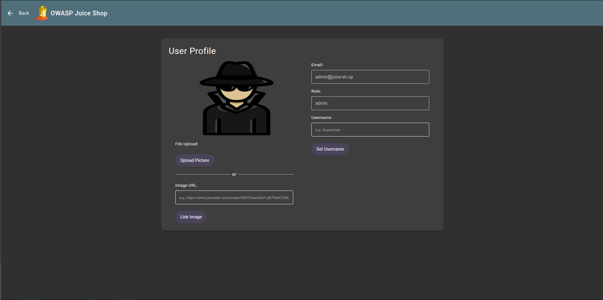
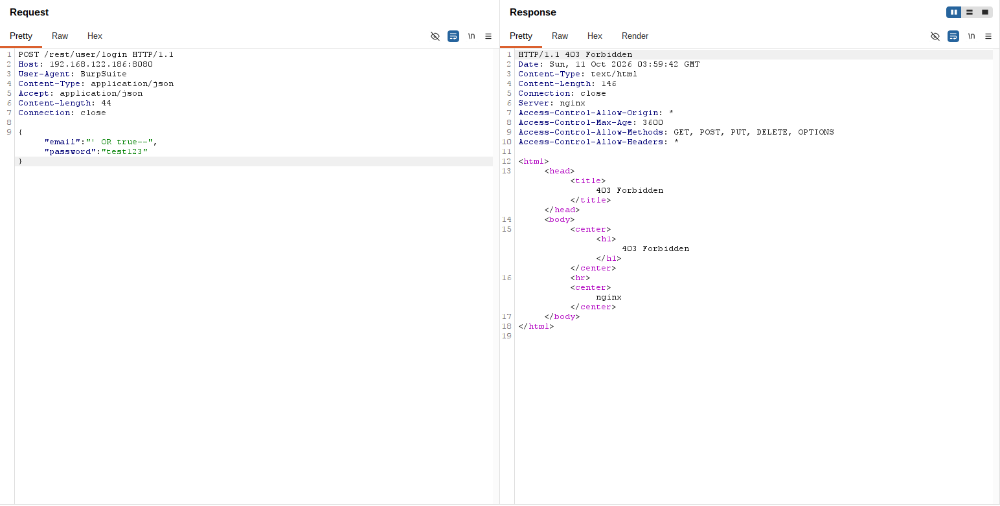
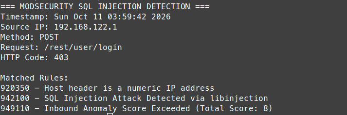
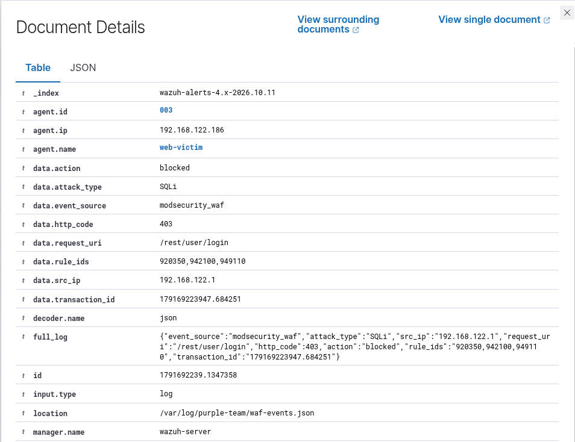
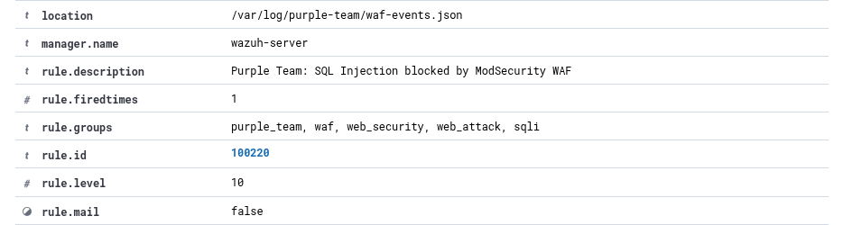

# Incident 002 – Phát hiện và ngăn chặn SQL Injection

## 1. Tổng quan

Kịch bản thực hành kiểm thử lỗ hổng SQL Injection (SQLi) trên chức năng đăng nhập của ứng dụng OWASP Juice Shop trong môi trường lab cô lập.

Mục tiêu là kiểm chứng khả năng vượt qua cơ chế xác thực bằng SQL Injection, đồng thời đánh giá khả năng phát hiện và ngăn chặn request tấn công của ModSecurity kết hợp OWASP Core Rule Set (CRS), cũng như khả năng giám sát sự kiện thông qua Wazuh SIEM.

| Thông tin | Chi tiết |
|---|---|
| Loại tấn công | SQL Injection – Authentication Bypass |
| Máy kiểm thử | Linux Mint – 192.168.122.1 |
| Máy mục tiêu | web-victim – 192.168.122.186 |
| Ứng dụng | OWASP Juice Shop |
| Cổng ứng dụng trực tiếp | 3000 |
| Cổng WAF | 8080 |
| Công cụ | Burp Suite, ModSecurity, OWASP CRS, Wazuh |
| Custom Rule | 100220 – Level 10 |
| Kết quả | Kiểm thử Login Bypass và phát hiện, ngăn chặn SQLi qua WAF |

## 2. Thực hiện kiểm thử SQL Injection

### 2.1. Kiểm thử Login Bypass

Truy cập trực tiếp chức năng đăng nhập của OWASP Juice Shop thông qua cổng 3000, không đi qua ModSecurity WAF.

Sử dụng payload SQL Injection tại trường Email:

`' OR true--`

Mật khẩu kiểm thử:

`test123`

Payload được sử dụng nhằm thay đổi logic điều kiện truy vấn SQL để thử vượt qua quá trình xác thực mà không cần cung cấp mật khẩu hợp lệ.

Quá trình kiểm thử trong ứng dụng lab ghi nhận khả năng vượt qua bước đăng nhập bằng payload SQL Injection.

**Nhận xét:** Kết quả minh họa nguy cơ Authentication Bypass khi ứng dụng xử lý đầu vào không an toàn trong câu truy vấn SQL. Đây là hoạt động kiểm thử trên ứng dụng được thiết kế cố tình chứa lỗ hổng.

### 2.2. Kiểm thử SQL Injection thông qua WAF

Tiếp tục sử dụng Burp Suite Repeater để gửi HTTP POST Request chứa payload SQL Injection đến endpoint đăng nhập:

`POST /rest/user/login`

Request được gửi qua ModSecurity WAF tại:

`http://192.168.122.186:8080`

Dữ liệu JSON kiểm thử:

`{"email":"' OR true--","password":"test123"}`

Sau khi gửi request, WAF phản hồi:

**HTTP/1.1 403 Forbidden**

**Nhận xét:** Khác với quá trình truy cập trực tiếp ứng dụng, request được chuyển qua WAF đã bị từ chối. Kết quả cho thấy lớp bảo vệ có khả năng ngăn chặn mẫu SQL Injection được sử dụng trong kịch bản này.

## 3. Phân tích cảnh báo ModSecurity

Tiến hành kiểm tra ModSecurity Audit Logs trên máy `web-victim` để xác định nguyên nhân request bị chặn.

Kết quả ghi nhận các rule sau:

| Rule ID | Nội dung phát hiện |
|---|---|
| 920350 | HTTP Host Header sử dụng địa chỉ IP |
| 942100 | Phát hiện SQL Injection bằng libinjection |
| 949110 | Tổng điểm bất thường vượt ngưỡng chặn |

Trong đó, `942100` là rule trực tiếp nhận diện dấu hiệu SQL Injection trong request, còn `949110` thực hiện đánh giá tổng điểm bất thường theo cơ chế Anomaly Scoring của OWASP CRS.

ModSecurity trả về HTTP 403, xác nhận request đã bị ngăn chặn.

**Nhận xét:** Cảnh báo từ rule 942100 cung cấp bằng chứng cho thấy WAF đã phát hiện dấu hiệu SQL Injection, thay vì chỉ dựa vào HTTP 403 để kết luận có hành vi tấn công.

## 4. Phân tích cảnh báo trên Wazuh SIEM

ModSecurity Audit Logs được thu thập và xử lý bằng Python WAF Log Normalizer, sau đó lưu thành các sự kiện JSON có cấu trúc tại:

`/var/log/purple-team/waf-events.json`

Wazuh Agent trên máy `web-victim` chuyển những sự kiện này đến Wazuh Manager.

Custom Detection Rule `100220` được cấu hình để phát hiện các sự kiện có nguồn `modsecurity_waf`, loại tấn công `SQLi` và HTTP Status Code `403`.

**Thông tin cảnh báo thực tế:**

| Trường | Giá trị |
|---|---|
| Rule ID | 100220 |
| Rule Level | 10 |
| Agent | web-victim |
| Source IP | 192.168.122.1 |
| Request URI | /rest/user/login |
| Attack Type | SQLi |
| Event Source | modsecurity_waf |
| Action | blocked |
| HTTP Code | 403 |
| ModSecurity Rules | 920350, 942100, 949110 |
| Decoder | json |

Wazuh Dashboard ghi nhận cảnh báo:

**Purple Team: SQL Injection blocked by ModSecurity WAF**

**Nhận xét:** Wazuh tiếp nhận thành công sự kiện từ ModSecurity và kích hoạt Custom Rule 100220 ở Level 10. Cảnh báo cung cấp các thông tin cần thiết để phân tích request tấn công, xác định nguồn phát sinh và đánh giá hành động ngăn chặn của WAF.

## 5. Kết quả và đánh giá

Kịch bản thực hành đã kiểm chứng hoạt động tấn công và phòng thủ đối với SQL Injection trên ứng dụng OWASP Juice Shop.

Luồng xử lý:

**Burp Suite → ModSecurity WAF → Python Log Normalizer → Wazuh Agent → Wazuh Manager → Wazuh Dashboard**

Kết quả đạt được:

- Kiểm thử SQL Injection Login Bypass trên ứng dụng web cố tình có lỗ hổng.
- Gửi request SQL Injection qua Burp Suite Repeater.
- ModSecurity và OWASP CRS phát hiện hành vi SQL Injection thông qua rule 942100.
- WAF ngăn chặn request và trả về HTTP 403.
- Python Log Normalizer chuyển dữ liệu ModSecurity thành JSON.
- Wazuh tạo cảnh báo với Custom Rule 100220, Level 10.
- Xác nhận sự kiện trên Wazuh Dashboard.

**Đánh giá:** Kịch bản cho thấy hiệu quả của việc kết hợp kiểm thử bảo mật ứng dụng web với WAF và SIEM để phát hiện, ngăn chặn và giám sát hành vi SQL Injection.

Tuy nhiên, cổng 3000 vẫn cho phép truy cập trực tiếp vào ứng dụng trong mạng lab, nên có thể bỏ qua WAF. Khi triển khai thực tế cần hạn chế truy cập trực tiếp backend, buộc lưu lượng đi qua reverse proxy và đồng thời khắc phục lỗ hổng SQL Injection trong mã nguồn ứng dụng.

**Trạng thái cuối cùng: SQL Injection Detected and Blocked by WAF.**