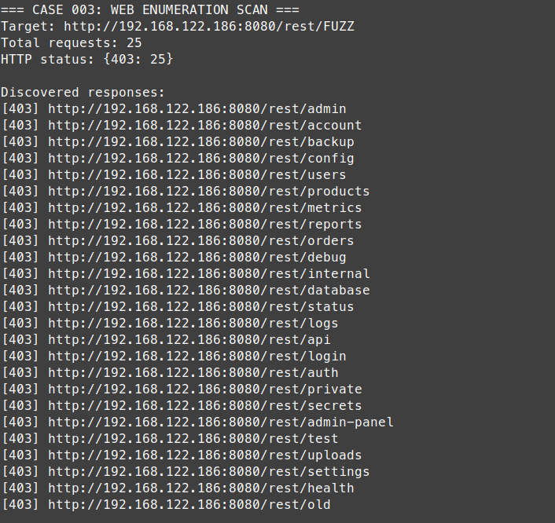
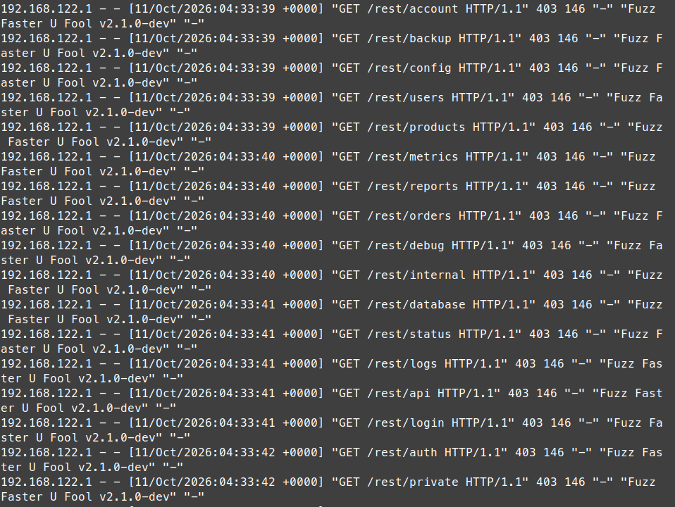
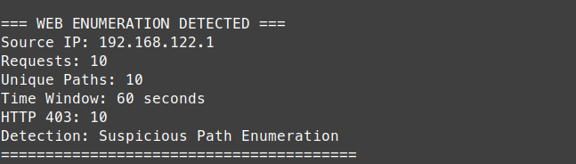
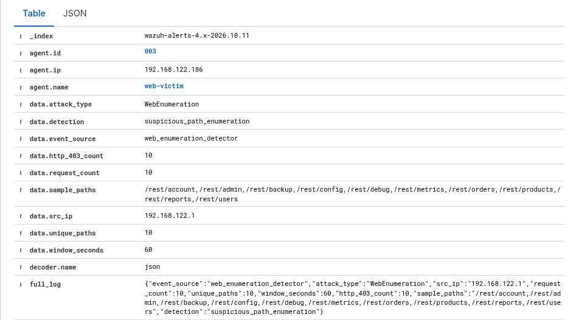
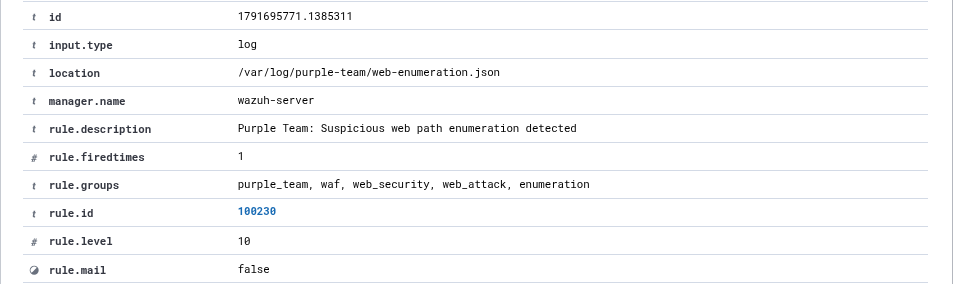

# Incident 003 – Phát hiện hành vi Web Enumeration

## 1. Tổng quan

Kịch bản thực hành mô phỏng hành vi Web Enumeration trên ứng dụng OWASP Juice Shop trong môi trường lab cô lập.

Mục tiêu là thực hiện dò tìm các đường dẫn của ứng dụng web bằng công cụ ffuf, phân tích HTTP Access Logs từ Nginx và xây dựng Python Detection Tool nhằm phát hiện một địa chỉ IP truy cập nhiều đường dẫn khác nhau trong khoảng thời gian ngắn.

Các sự kiện được chuyển đến Wazuh SIEM để phục vụ giám sát và điều tra hành vi đáng ngờ.

| Thông tin | Chi tiết |
|---|---|
| Kịch bản | Web Enumeration & Detection |
| Máy kiểm thử | Linux Mint – 192.168.122.1 |
| Máy mục tiêu | web-victim – 192.168.122.186 |
| Ứng dụng | OWASP Juice Shop |
| WAF | ModSecurity + OWASP CRS |
| Công cụ | ffuf, Python, Nginx, Wazuh |
| Custom Rule | 100230 – Level 10 |
| Kết quả | Phát hiện hành vi Web Enumeration thành công |

## 2. Thực hiện Web Enumeration

Sử dụng công cụ ffuf để gửi nhiều HTTP GET Request đến các đường dẫn khác nhau thuộc `/rest/` trên OWASP Juice Shop thông qua ModSecurity WAF.

Wordlist thực hành gồm 25 đường dẫn, chẳng hạn `admin`, `backup`, `config`, `users`, `products`, `debug`, `login` và `internal`.

Cấu hình kiểm thử:

| Tham số | Giá trị |
|---|---|
| Target | http://192.168.122.186:8080/rest/FUZZ |
| Số đường dẫn | 25 |
| Tốc độ giới hạn | 5 request/giây |
| Số worker | 1 |
| Phương thức | GET |

Quá trình kiểm thử ghi nhận 25 HTTP Request và toàn bộ trả về trạng thái **403 Forbidden**, không xuất hiện lỗi kết nối.

**Nhận xét:** Công cụ ffuf đã thực hiện hoạt động dò tìm đường dẫn thành công ở mức gửi request. Các phản hồi HTTP 403 cho thấy request bị từ chối nhưng chưa đủ để kết luận WAF phát hiện hành vi Enumeration dựa trên tần suất truy cập.

## 3. Phân tích Nginx Access Logs và ModSecurity

Tiến hành kiểm tra Nginx Access Logs trên máy `web-victim` sau khi hoàn thành quá trình kiểm thử.

Kết quả ghi nhận nhiều HTTP GET Request liên tiếp từ địa chỉ `192.168.122.1` đến các đường dẫn khác nhau:

- `/rest/admin`
- `/rest/account`
- `/rest/backup`
- `/rest/config`
- `/rest/users`
- `/rest/products`

Các request được gửi trong khoảng thời gian ngắn, sử dụng User-Agent của công cụ ffuf và nhận HTTP Status Code 403.

Khi phân tích chi tiết ModSecurity Audit Logs, các rule sau được ghi nhận:

| Rule ID | Nội dung |
|---|---|
| 913100 | Phát hiện User-Agent liên quan đến công cụ quét bảo mật |
| 920350 | HTTP Host Header sử dụng địa chỉ IP |
| 949110 | Tổng điểm bất thường vượt ngưỡng chặn |

**Nhận xét:** ModSecurity nhận diện dấu hiệu công cụ quét thông qua User-Agent và các đặc điểm HTTP Request. Tuy nhiên, cơ chế này khác với việc phát hiện nhiều đường dẫn được truy cập trong một khoảng thời gian ngắn. Vì vậy, cần bổ sung detection dựa trên hành vi.

## 4. Xây dựng Python Web Enumeration Detector

Một công cụ Python được xây dựng để theo dõi Nginx Access Logs và phát hiện hành vi truy cập bất thường theo Source IP.

Công cụ đọc log từ Docker, trích xuất các thông tin như IP nguồn, thời gian, HTTP Method, Request URI và HTTP Status Code.

**Điều kiện phát hiện:**

| Tiêu chí | Giá trị |
|---|---|
| Nguồn dữ liệu | Nginx Access Logs |
| Đường dẫn giám sát | /rest/ |
| Ngưỡng phát hiện | 10 đường dẫn khác nhau |
| Khoảng thời gian | 60 giây |
| Phương pháp | Behavioral Detection |

Detector nhóm các request theo Source IP và sử dụng cửa sổ thời gian 60 giây để thống kê số lượng đường dẫn khác nhau.

Khi số lượng đường dẫn đạt ngưỡng, công cụ sinh sự kiện cảnh báo dưới dạng JSON.

**Kết quả kiểm thử thực tế:**

| Trường | Giá trị |
|---|---|
| Source IP | 192.168.122.1 |
| Requests | 10 |
| Unique Paths | 10 |
| Time Window | 60 giây |
| HTTP 403 | 10 |
| Detection | Suspicious Path Enumeration |

**Nhận xét:** Python Detector đã phát hiện một địa chỉ IP truy cập 10 đường dẫn khác nhau trong thời gian ngắn. Phương pháp này không phụ thuộc vào User-Agent của ffuf mà dựa trên hành vi truy cập thực tế.

Công cụ được cấu hình chạy tự động thông qua systemd service `web-enumeration-detector`.

## 5. Phân tích cảnh báo trên Wazuh SIEM

Python Detector ghi sự kiện JSON vào:

`/var/log/purple-team/web-enumeration.json`

Wazuh Agent trên máy `web-victim` thu thập file log và chuyển đến Wazuh Manager.

Custom Detection Rule `100230` được xây dựng để nhận diện sự kiện `WebEnumeration` do Python Detector tạo ra.

**Thông tin cảnh báo thực tế:**

| Trường | Giá trị |
|---|---|
| Rule ID | 100230 |
| Rule Level | 10 |
| Agent | web-victim |
| Source IP | 192.168.122.1 |
| Attack Type | WebEnumeration |
| Request Count | 10 |
| Unique Paths | 10 |
| Window Seconds | 60 |
| HTTP 403 Count | 10 |
| Decoder | json |

Wazuh Dashboard hiển thị cảnh báo:

**Purple Team: Suspicious web path enumeration detected**

**Nhận xét:** Wazuh đã tiếp nhận sự kiện từ Python Detector và kích hoạt Custom Rule 100230 ở Level 10. Cảnh báo cung cấp các thông tin về IP nguồn, số lượng request, số đường dẫn khác nhau và khoảng thời gian phát hiện.

## 6. Kết quả và đánh giá

Kịch bản đã kiểm chứng thành công quy trình phát hiện hành vi Web Enumeration thông qua phân tích HTTP Access Logs.

**Luồng xử lý:**

ffuf → Nginx/ModSecurity → Access Logs → Python Enumeration Detector → Wazuh Agent → Wazuh Manager → Dashboard

Kết quả đạt được:

- Thực hiện Web Enumeration với 25 đường dẫn bằng công cụ ffuf.
- Xác nhận Nginx ghi nhận các HTTP Request và ModSecurity phát hiện User-Agent của công cụ quét.
- Xây dựng Python Detector theo dõi nhiều đường dẫn truy cập từ cùng một IP.
- Phát hiện 10 đường dẫn khác nhau trong cửa sổ 60 giây.
- Tự động tạo sự kiện JSON và chuyển đến Wazuh.
- Kích hoạt Custom Rule 100230, Level 10 và xác nhận cảnh báo trên Dashboard.

**Đánh giá:** Kịch bản thể hiện khả năng kết hợp Web Security Testing với Detection Engineering. Việc sử dụng Python giúp bổ sung cơ chế phát hiện dựa trên hành vi, thay vì chỉ phụ thuộc vào các signature của WAF.

Tuy nhiên, việc truy cập nhiều đường dẫn không tự động chứng minh có hành vi tấn công. Trong môi trường thực tế, cần điều